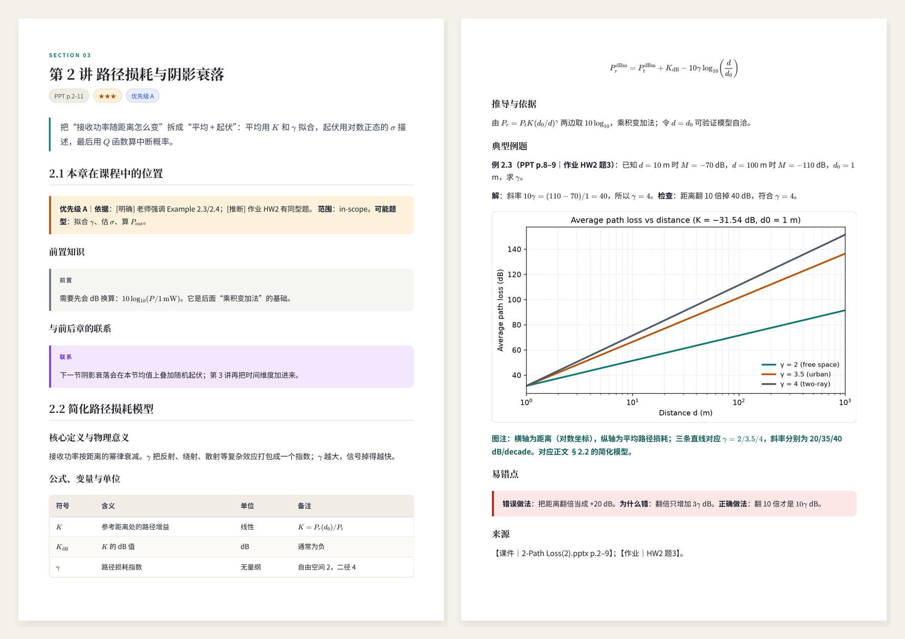
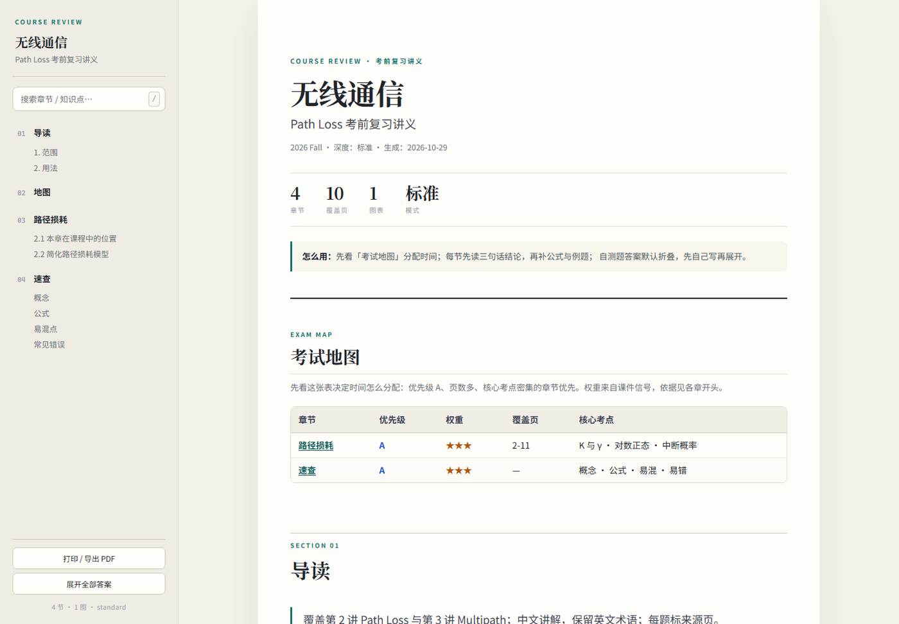

# course-exam-review

> 把课件、笔记、作业和往年题，变成一套能直接复习、直接自测的考试包。

一个面向 **电子系课程**（无线通信、微波工程、数字信号处理等）的 [Claude Code](https://claude.com/claude-code) skill。你只需要把课件和考试材料放进一个文件夹，它会自动完成材料梳理、知识体系重组、中文精讲讲义、英文自测题、速查表、复习计划、覆盖检查和源文件打包。

不是“把 PPT 压缩一遍”，而是按考试的方式重新组织：**哪些必须背、公式怎么来的、例题怎么下手、哪里最容易错、还剩几天怎么安排。**

<p align="center">
  
  
</p>

<p align="center"><sub>左：生成的 A4 讲义（章节页 + 例题/图表页）；右：离线网页（侧栏目录、搜索、考试地图）。</sub></p>

## Quick start

```bash
git clone https://github.com/pussiecatcat/course-exam-review.git ~/.claude/skills/course-exam-review
cd ~/.claude/skills/course-exam-review
python -m pip install -r requirements.txt
```

Windows PowerShell：

```powershell
git clone https://github.com/pussiecatcat/course-exam-review.git "$HOME\.claude\skills\course-exam-review"
cd "$HOME\.claude\skills\course-exam-review"
python -m pip install -r requirements.txt
```

然后在 Claude Code 里输入 `/course-exam-review`，把课件文件夹指给它。完整安装、可选依赖和输入说明见下方「安装」。

---

## 为什么做这个

考前一周最常见的六个问题：

- 课件太多，怕漏；
- 章节之间联系不清，学完像一堆孤岛；
- 课件太简略，关键推导一笔带过；
- 英文课件读得慢，考试却要用英文答题；
- 看懂了，但不会做题；
- 不知道重点在哪，时间不够用。

这个 skill 把这些问题拆成可执行的步骤：**完整覆盖 + 知识地图 + 推导补全 + 中英对照 + 例题/自测 + 优先级 + 复习计划 + 覆盖核查**。

---

## 它会产出什么

| 交付物 | 内容 |
|---|---|
| **完整讲义 PDF / HTML / Markdown** | 导读、知识地图、各章精讲、速查、自测、答案、计划、覆盖 |
| **英文自测题** | 英文题干 + 中文思路解析 + 英文参考答案；题目与答案分开成两个 PDF |
| **速查资料** | 核心概念、公式、易混点、常见错误四张表 + 考前 10 分钟清单 |
| **复习计划** | 按考试日期、每日可用时长、知识点优先级和前置依赖排程，预留 20% 自测/错题 |
| **覆盖与待核对** | 每一页课件归到哪一节；无法确认的公式/图/文字单独列出 |
| **可重编译源文件** | Markdown、图片、meta、脚本、模板、离线 KaTeX；用附带脚本重新生成 PDF |

---

## 工作流

```
材料盘点
  → 考试画像（日期/时长/范围/题型/开闭卷/老师强调/作业/往年题）
  → 逐页提取（PPT 渲染 + 文本 + 备注 + 视频关键帧）
  → 知识地图（按知识体系重排，合并重复，标前置/联系/优先级）
  → 各章精讲（定义/条件/公式/单位/推导/联系/易混/例题/图注/来源）
  → 英文自测（题目与答案分开，标往年题/作业/自编）
  → 速查 + 复习计划 + 覆盖报告
  → HTML / PDF / 源文件包
  → 质检（公式、中文、图片、目录、交叉引用、Q/A 编号、源文件重编译）
```

---

## 安装

需要 Python 3.10+、Claude Code，以及：

```bash
python -m pip install -r requirements.txt
```

`requirements.txt` 包含 PyMuPDF、python-pptx、python-docx、Pillow；Windows 上还包含用于 PowerPoint 渲染的 `pywin32`。

把仓库克隆到 Claude Code 的用户级 skill 目录：

```bash
git clone https://github.com/pussiecatcat/course-exam-review.git ~/.claude/skills/course-exam-review
```

Windows（PowerShell）：

```powershell
git clone https://github.com/pussiecatcat/course-exam-review.git "$HOME\.claude\skills\course-exam-review"
```

检查依赖：

```bash
python -c "import pymupdf, pptx, docx, PIL; print('deps ok')"
```

可选：

- **PPT 逐页渲染**：Windows 上装 PowerPoint（推荐）或 LibreOffice；两者都没有时只能抽文本/内嵌图。
- **PDF 导出**：Edge 或 Chrome。
- **视频抽帧**：`pip install opencv-python`。

---

## 使用

在 Claude Code 里直接输入：

```text
/course-exam-review
```

或者说：

```text
用 course-exam-review 复习 ~/Desktop/无线通信
考试 11 月 5 日，每天 3 小时，老师强调 Example 2.3/2.4
课件和往年题都在这个文件夹
```

它会先盘点材料，**只问真正影响处理的问题**（例如多门课混在一起时问哪一份）。普通偏好用默认值：

- 没给考试日期 → 默认 7 天，并在计划里说明；
- 没给每日时长 → 只给任务顺序和预计耗时，不虚构时间表；
- 没给输出格式 → 默认 PDF + HTML + Markdown + 源文件包；
- 没给深度 → 默认 `standard`；
- 没给开闭卷/题型 → 不据此删内容，按常规准备并注明假设。

### 互动自测

完整资料交付后，说“开始自测”：

- 一次一题，英文题干；
- 回答前不显示答案；
- 回答后给中文解析 + 英文参考答案；
- 记录 `.review/self_test_log.json`；
- 每 5–10 题总结薄弱知识点，并回链讲义章节和原始课件页码。

---

## 输出结构

```
course-review/
├── course-review.pdf
├── index.html                 # 离线网页：目录、搜索、答案折叠、打印
├── course-review.md
├── quick-reference.pdf        # 可选
├── self-test/
│   ├── questions.pdf          # 只有题目
│   ├── answers.pdf            # 中文解析 + 英文答案
│   ├── questions.md
│   ├── answers.md
│   └── bank.json              # 互动自测题库
├── figures/
├── assets/                    # 样式、脚本、离线 KaTeX
└── source/                    # 可重新编译的源文件
    ├── content/
    ├── figures/
    ├── meta.json
    ├── exam_profile.json
    ├── knowledge_points.csv
    ├── outline.md
    ├── coverage.csv
    ├── TO_VERIFY.md
    ├── scripts/
    ├── templates/
    ├── assets/
    └── README.md
```

---

## 质量门槛

- **覆盖**：非封面/目录页 100% 归节；读不懂的页标 `to-verify`，不静默跳过。
- **来源**：每个公式、例题、图能追到课件页码/作业题号/往年题年份。
- **推导**：课件省略的关键步骤补全，标 `【补充】`；前置知识用 `prereq` 块补讲。
- **优先级**：A/B/C/D + `[明确]` / `[推断]`；只有明确要求才写“必考”。
- **自测**：Q/A 编号一一对应；英文题干、中文解析、英文答案齐全；自编题标 `【自测·生成】`，不冒充往年题。
- **计划**：说明假设；预留约 20% 自测/错题；范围外内容单列。
- **PDF**：检查中文、公式、图片、分页、目录、交叉引用；源文件能重新编译。

---

## 适用与限制

**适合**：电子系本科课程；中英混合 PPT/PPTX/PDF 课件；有考试范围、老师强调、作业、往年题更好。

**不适合**：没有材料凭空生成重点；替用户写课程论文/实验报告；把教材内容另起炉灶讲一遍。

**限制**：

- PPT 渲染依赖 PowerPoint/LibreOffice；没有时版式可能不完整。
- 视频抽帧依赖 `opencv-python`；没有时标“需回看原 PPT”，不臆测画面。
- 复习计划是启发式排程，不是最优解，生成后可按实际进度微调。
- 源文件重编译需要相同字体/浏览器环境。

---

## 验证

仓库内 [VALIDATION.md](VALIDATION.md) 记录了：

- 8 个脚本全部通过 `py_compile`；
- 端到端合成样例：8 章、13 页主 PDF、1 页题目 PDF、1 页答案 PDF、2 页速查；
- 计划、覆盖、自测题库、源文件打包与重编译；
- 质检 PASS，0 失败。

---

## 目录

```
SKILL.md                 # skill 入口与完整流程
references/              # 内容模板、考试画像、流程、交付物、质检、互动自测
scripts/                 # ingest / build / print_pdf / check / plan / coverage / selftest / package
assets/                  # style.css / app.js / 离线 KaTeX
templates/               # HTML 模板、考试画像与知识点表示例
docs/                    # README 预览图
requirements.txt         # Python 依赖
VALIDATION.md            # 验证报告
```

---

## License

MIT。见 [LICENSE](LICENSE)。

KaTeX 以 MIT 协议随仓库分发，版权归 Khan Academy 及其他贡献者；完整许可见 [assets/katex/LICENSE](assets/katex/LICENSE)。
